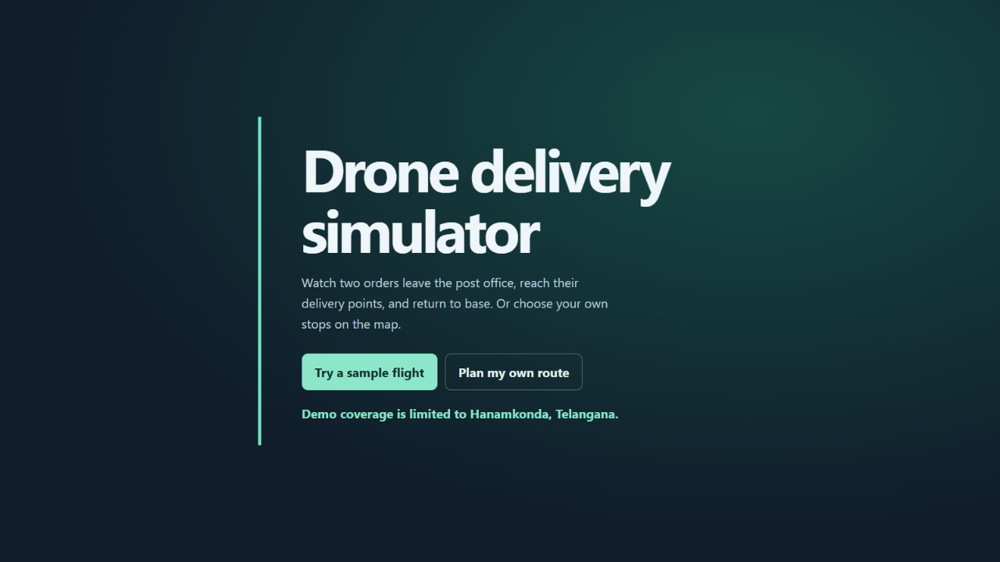
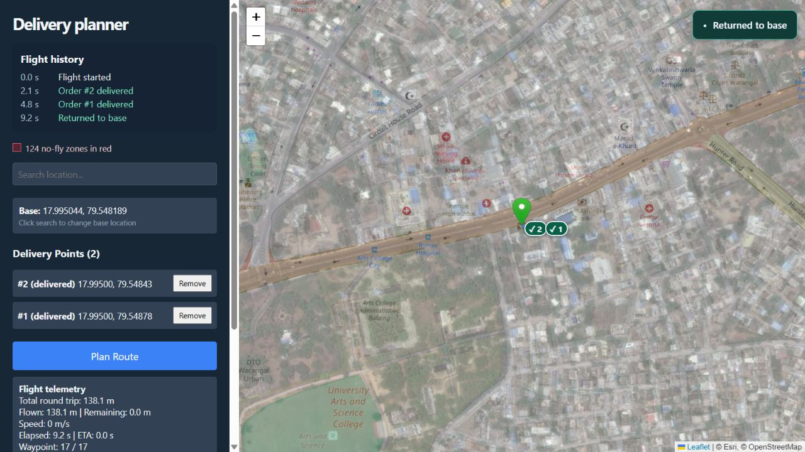

# Drone delivery simulator

Plan a multi-stop delivery flight from Hanamkonda Head Post Office in Telangana, India. Choose **Try a sample flight** to watch two orders arrive, or place stops on the map to plan a custom round trip. Demo coverage is limited to Hanamkonda.

## How a flight works

1. Place orders on the map. Each order keeps its number when the planner changes the visit order.
2. Flask selects the nearest outstanding stop by straight-line distance and uses a randomized tree planner to find each leg around the bundled no-fly polygons.
3. The browser follows the resulting waypoints at a simulated 15 m/s. When it reaches a delivery checkpoint, the marker turns green and the flight history records the time.
4. The drone returns to base. Telemetry shows total distance, distance remaining, elapsed time, ETA, and estimated charge. The battery model assumes 30 minutes per full charge.

In the pictured run, order 2 was closer to base and arrived first. The route was 138.1 m and took 9.2 seconds. Subsequent plans can produce different paths.

## Technology and data

| Component | Implementation |
| --- | --- |
| Dashboard and playback | React 18, Vite, Axios |
| Map | Leaflet, React Leaflet, Esri imagery and OpenStreetMap cartography |
| API and route sequencing | Python, Flask, Flask-CORS |
| Geospatial processing | GeoPandas, Shapely, PyProj, OSMnx |
| Bundled environment | GeoJSON with 124 demo restricted zones and two building features |

The red polygons show the dataset used by the planner. They represent simulated restrictions. The nearest-stop rule is a heuristic, and the resulting round trip can vary. Map tiles and location search require internet access.

## Run locally

Follow [RUN_COMMANDS.md](RUN_COMMANDS.md) to start Flask on port 5002 and the Vite dashboard on port 5173. The bundled environment supports the sample flight immediately after dependency installation.

## Source layout

- `backend/app.py` exposes health, base, delivery and route endpoints.
- `backend/core/` implements stop validation, sequencing, spatial checks and route planning.
- `backend/data/` contains the base and map layers used at launch.
- `frontend/src/` contains the launch screen, map, playback and delivery notifications.
- `docs/images/` contains screenshots of the running application.

## Hosting considerations

The current frontend targets a local Flask API. Public hosting requires a production API address or same-origin routing. Pending orders currently live in backend process memory and are shared between requests.
